<div align="center">

# CULTIVA

### Choosing the right crop rotation to manage water better in Morocco

*Agricultural decision support based on NASA satellite data and the FAOSTAT database*

**NASA Space Apps Challenge 2026 · CULTIVA Team**


<br>

<a href="docs/images/01-accueil.png">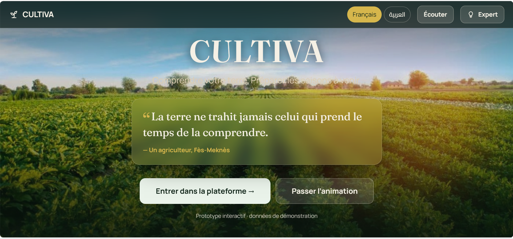</a>

</div>

---

## Table of contents

1. [Platform overview](#platform-overview)
2. [Context and problem](#context-and-problem)
3. [Our goal](#our-goal)
4. [How CULTIVA works](#how-cultiva-works)
5. [Data: a clear role for each source](#data-a-clear-role-for-each-source)
6. [The recommendation engine](#the-recommendation-engine)
7. [Farmer journey](#farmer-journey)
8. [Technical architecture](#technical-architecture)
9. [Installation and launch](#installation-and-launch)
10. [API](#api)
11. [Repository structure](#repository-structure)
12. [Honesty principle and limitations](#honesty-principle-and-limitations)
13. [Future work](#future-work)
14. [AI tools used](#ai-tools-used)

---

## Platform overview

The farmer's journey takes 6 steps, from locating the plot to the sowing calendar. The **Expert
mode** exposes the whole methodology.

> The interface is available in French and Arabic; the screenshots below show the French version
> Click any screenshot to open it at full size.

### The 6 steps

#### Step 1 — My farm: locate the plot

Locate the plot using GPS, a city name or the map.

<p align="center">
  <a href="docs/images/02-localisation.png">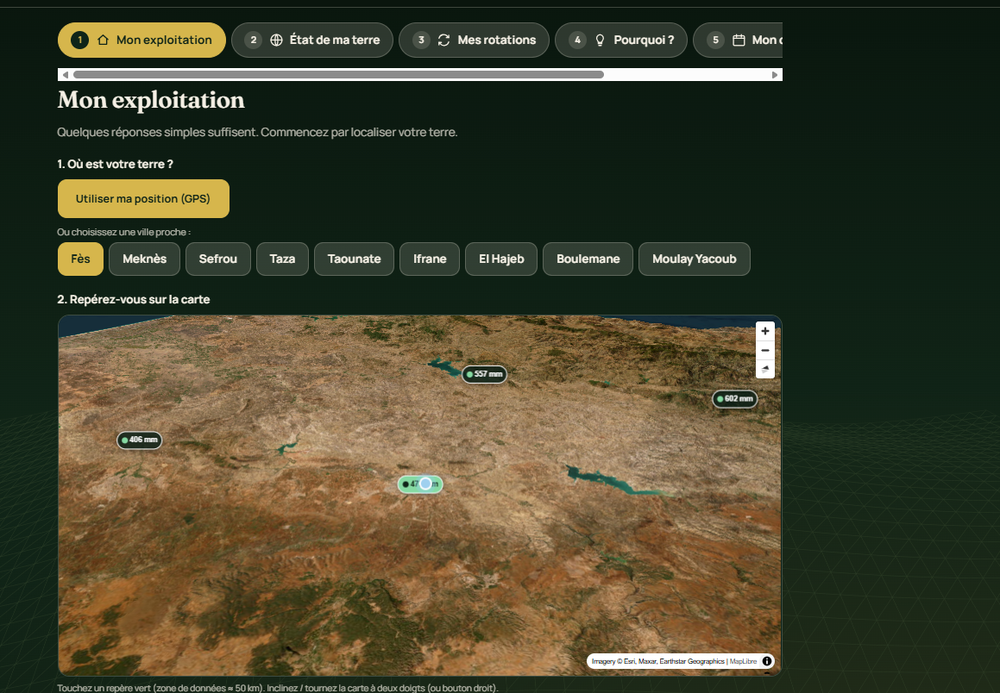</a>
</p>

#### Step 1 (continued) — My farm: soil, last harvested crop and priority

Choose the soil, the last crop harvested on the plot and the farmer's priority.

<p align="center">
  <a href="docs/images/03-sol-culture-priorite.png">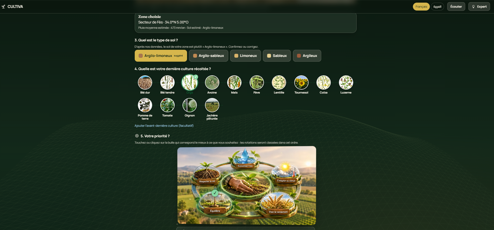</a>
</p>

#### Step 2 — State of my land

Water, rain, vegetation, soil and drought, read from the NASA data of the zone.

<p align="center">
  <a href="docs/images/04-etat-de-la-terre.png">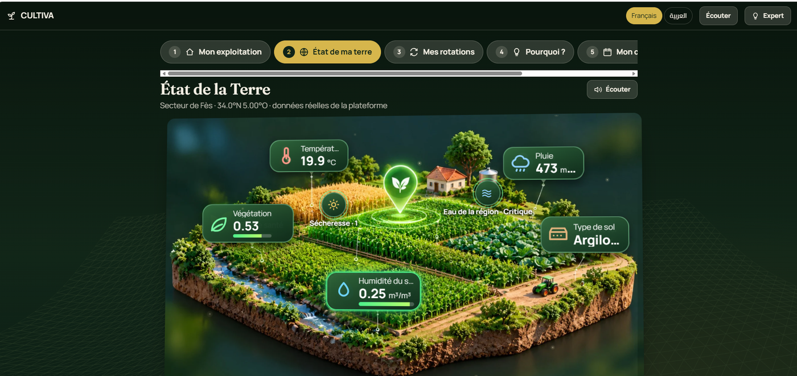</a>
</p>

#### Step 3 — My rotations

The current rotation and 2 proposed rotations.

<p align="center">
  <a href="docs/images/05-rotations-proposees.png">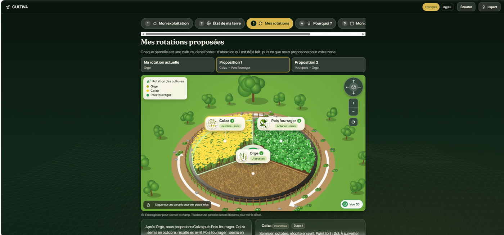</a>
</p>

#### Step 4 — Why this rotation

An explanation of each proposal: scores and rules applied.

<p align="center">
  <a href="docs/images/06-pourquoi-cette-rotation.png">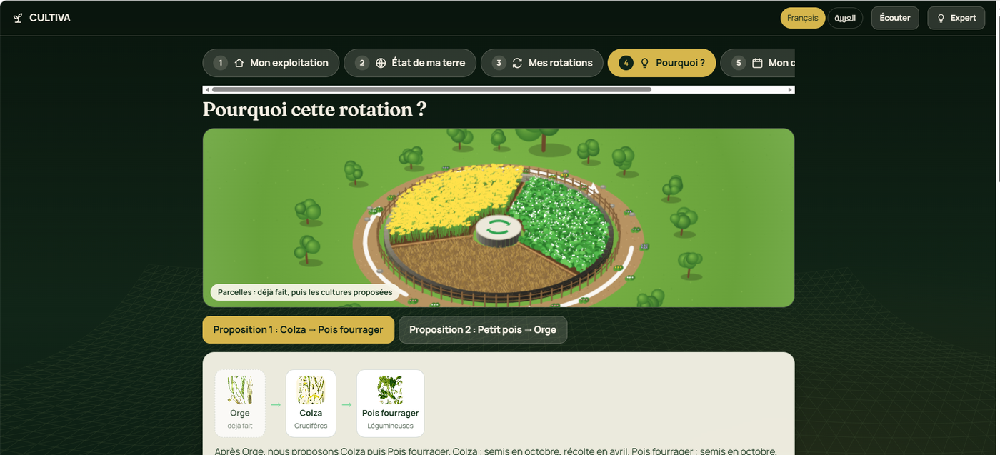</a>
</p>

#### Step 5 — My calendar

Bare soil, sowing, growth and harvest over the year.

<p align="center">
  <a href="docs/images/07-calendrier-agricole.png">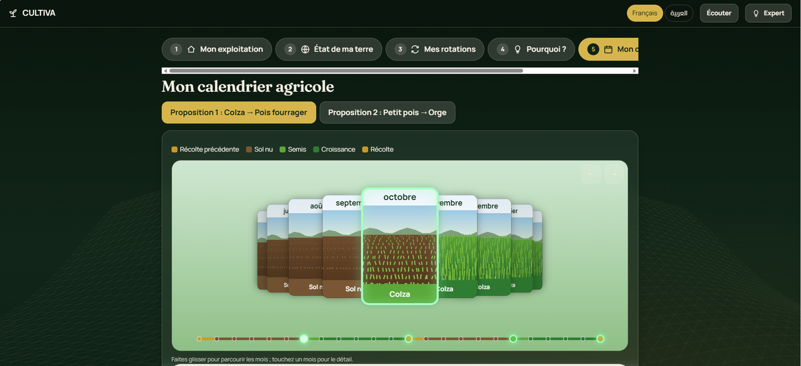</a>
</p>

#### Step 6 — Community

Sample testimonials (prototype).

<p align="center">
  <a href="docs/images/08-communaute.png">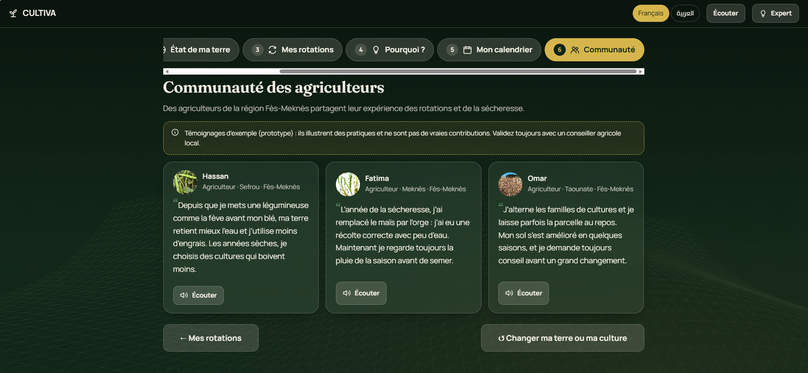</a>
</p>

### Expert mode: the methodology, fully transparent

#### How a rotation is built

<p align="center">
  <a href="docs/images/09-mode-expert-methodologie.png">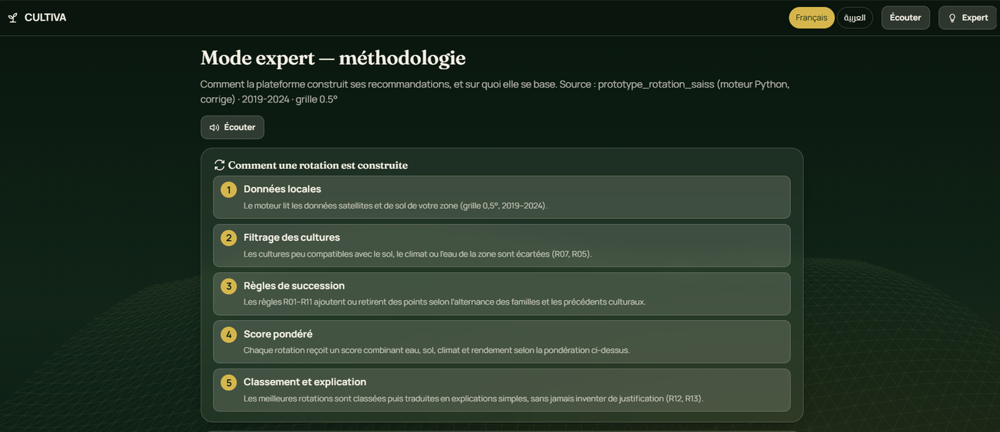</a>
</p>

#### Score weighting and rules R01–R13

<p align="center">
  <a href="docs/images/10-mode-expert-ponderation-regles.png">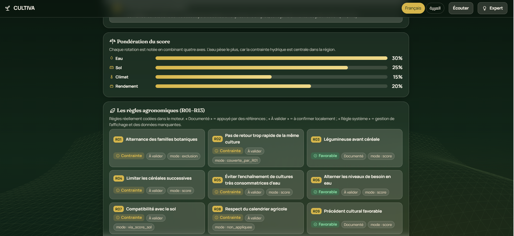</a>
</p>

#### Data sources and scientific safeguards

<p align="center">
  <a href="docs/images/11-mode-expert-sources.png">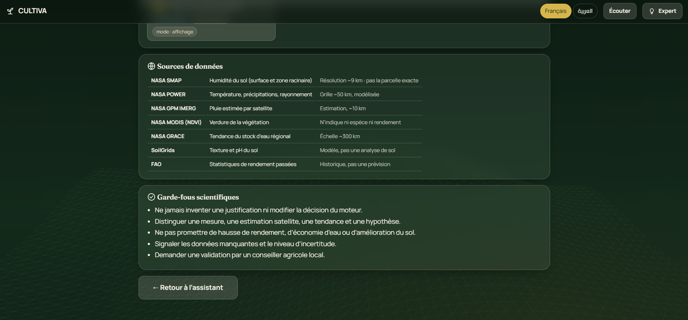</a>
</p>

---

## Context and problem

Morocco is one of the countries most exposed to **water stress** in the Mediterranean. More
frequent droughts, irregular rainfall and falling groundwater levels weaken an agricultural sector
that remains a pillar of the economy and of rural employment. Yet agriculture is the country's
largest consumer of water.

In this context, every season a farmer has to decide **what to sow after the previous harvest**,
often without easy access to objective data on the state of the water, soil and climate of the
plot.

> **The question CULTIVA answers:**
> *Which crop or which rotation is the most favourable for my plot, respecting the water
> resource, preserving the soil and remaining profitable for me?*

---

## Our goal

CULTIVA is a platform that addresses the challenge of **climate change and water management in
Morocco** by turning satellite data, until now reserved for experts, into **clear, explained
rotation recommendations that a farmer can use**.

Three requirements guide every proposal:

| Requirement | What it means in CULTIVA |
|---|---|
| **Save water** | Take into account soil moisture, rainfall and groundwater status so as not to propose water-hungry crops where water is limited. |
| **Preserve the soil** | Respect agronomic rotation rules (alternate cereals and legumes, avoid harmful sequences). |
| **Stay profitable** | Take into account the expected yield of the crops, so that the recommendation also serves the farmer's economic interest. |

### Why Fès-Meknès

This **first version** targets the **Saïss / Fès-Meknès** region, a major agricultural area of
Morocco and a good testing ground: diverse crops, with real groundwater and rainfall issues. It
covers **13 zones** on a 0.5° grid. The engine is designed to be extended to other regions of the
country.

---

## How CULTIVA works

The central idea: **combine several data sources, each with a distinct role**, to build an
objective score for each crop, then for each rotation.

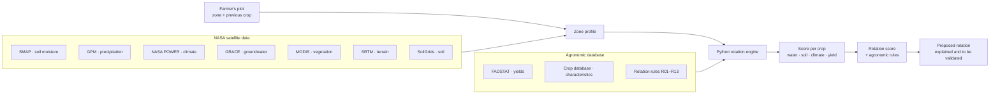

In short:

1. **NASA data describe the plot**: which water, which soil, which climate, which fragility.
2. **FAOSTAT and the crop database describe the crops**: their needs, characteristics and yields.
3. **The engine confronts the two**: a crop is favourable when its needs are compatible with what
   the zone can actually offer.
4. **The agronomic rules** assemble the crops into a **coherent rotation**.

---

## Data: a clear role for each source

No data is decorative: each source feeds a specific part of the decision.
Reference period: **2019–2024**.

### NASA satellite data: describing the zone

| Source | What it measures | Role in the recommendation |
|---|---|---|
| **SMAP** | Soil moisture | Feeds the **water** axis: immediate availability of water in the soil. |
| **GPM** | Precipitation | Feeds the **water** axis: the actual rainfall input of the zone. |
| **NASA POWER** | Climate variables (temperature, radiation…) | Feeds the **climate** axis: thermal and climatic suitability of the crops. |
| **GRACE / GRACE-FO** | Variation of the groundwater storage | **Supervision layer**: adjusts the water constraint according to the groundwater trend. A falling water table makes the engine more restrictive. |
| **MODIS** | Vegetation index | **Supervision layer**: feeds a **fragility** index of the zone. |
| **SRTM** | Terrain and slope | Contributes to the reading of the terrain (slope, physical constraints of the plot). |
| **SoilGrids** | Soil properties and texture | Feeds the **soil** axis: compatibility between the crop and the soil of the zone. |

### Agronomic data: describing the crops

| Source | Content | Role in the recommendation |
|---|---|---|
| **FAOSTAT** | Agricultural statistics, including **yields** | Feeds the **yield** axis: favours high-performing, profitable crops. |
| **Crop database** | Several crops with their **characteristics** (needs, cycle, botanical family…) | Finds the most favourable crops by comparing their characteristics with the conditions of the zone. |
| **Associations & rules R01–R13** | Agronomic rotation rules | Exclusions and bonuses/penalties: avoid two cereals in a row, reward a legume after a cereal, etc. |

---

## The recommendation engine

The engine (`backend/rotation_engine.py`, class `Engine`) is configured by
`backend/config/engine_config.json`.

### 1. Crop score

Weighted combination of **4 axes**:

| Axis | Weight | Mainly fed by |
|---|:---:|---|
| Water | **0.30** | SMAP, GPM, GRACE |
| Soil | **0.25** | SoilGrids, SRTM |
| Climate | **0.15** | NASA POWER |
| Yield | **0.20** | FAOSTAT, crop database |

> Water weighs the most: it is the heart of the challenge.

### 2. Rotation score

```
rotation_score = 0.9 × (crop quality) + 0.1 × (agronomic rules)
```

The proposed sequence must also **fit within the year** (`cycle_max_jours = 365`).

### 3. Supervision layers

- **GRACE** adjusts the water constraint according to the **groundwater trend** of the zone.
- **MODIS** feeds a **fragility index** of the zone.

### 4. Agronomic rules R01–R13

Stored in `backend/data/base_agronomique/rotation_rules_moteur.csv`. Each proposal
**lists the rules applied and their effect**: the farmer sees *why* a rotation is recommended.

---

## Farmer journey

The interface (`frontend/index.html`) is a single-page application, **bilingual FR / AR** (with
RTL layout for Arabic), in **6 steps**:

1. **Home**
2. **Location**: GPS or map, to place the plot in one of the 13 zones.
3. **State of the land**: clickable image. Each element (soil water, rain, groundwater,
   fragility, texture, slope…) displays the text derived from the zone's data. Audio reading
   available.
4. **Priority and previous crop**: previous crop (and the one before if needed), then choice of
   the priority.
5. **Proposed rotation**: clickable rotation wheel; clicking a crop shows the real data (water /
   soil / climate / yield scores, rules applied).
6. **Why / Calendar**: detailed explanation of the scores and sowing timeline.

Also: **Expert mode** (methodology, weights, rules, GRACE/MODIS layers) and **Community**
(sample testimonials, flagged as such in the interface).

---

## Technical architecture

```
   Browser (frontend/index.html)
   SPA Vanilla JS · FR/AR · dark theme + 3D globe
                │  fetch  GET /api/rotations?zone=&prev=&prev2=
                ▼
   FastAPI API (backend/api.py)
                │
                ▼
   Python engine (backend/rotation_engine.py → Engine)
                │
                ▼
   NASA data + agronomic database (backend/data/, backend/etudes_output/)
```

- **Frontend**: a single HTML file, no build step.
- **Backend**: the real Python engine exposed by FastAPI (the same one used for the studies).
- **Real link**: every computation is sent as an HTTP request to the API.
- **Offline mode**: if the API is unreachable (e.g. the file is opened directly), the front end
  falls back to an embedded dataset so that a demo is still possible.

---

## Installation and launch

**Prerequisite:** Python 3.10+

```bash
git clone <repository-url>
cd cultiva

pip install -r requirements.txt
cd backend
uvicorn api:app --reload --port 8000
```

Then open **http://127.0.0.1:8000/**.

Shortcut: `./run.sh` installs the dependencies and starts the server.

### Using the engine directly in Python

```python
from rotation_engine import Engine

eng = Engine("etudes_output", "data/base_agronomique", "config/engine_config.json")
chosen, info, cs = eng.propose(lat=34.0, lon=-5.0, prev="ble_dur", prev2=None, length=2)
result = [eng.describe(r, cs) for r in chosen]
```

---

## API

| Route | Role |
|---|---|
| `GET /api/reference` | Reference data: metadata, 13 zones, crops, axes, rules R01–R13. |
| `GET /api/rotations?zone=&prev=&prev2=` | Live computation of 2 rotations (sequence, score, rules, scores per crop, status). |
| `GET /api/health` | Health check (zones and crops loaded). |
| `GET /` | Serves the frontend. |

```bash
curl "http://127.0.0.1:8000/api/rotations?zone=34.000_-5.000&prev=ble_dur"
```

Response: `{ recolte_precedente, eau_limitee, n_evaluees, n_exclues, propositions: [...] }`

---

## Repository structure

```
cultiva/
├── README.md
├── requirements.txt          # dependencies (used by run.sh)
├── run.sh                    # installs + starts the server
├── .gitignore
├── docs/
│   └── images/               # screenshots displayed in this README
├── frontend/
│   └── index.html            # SPA application FR/AR
└── backend/
    ├── api.py                # FastAPI API
    ├── rotation_engine.py    # rotation engine (Engine class)
    ├── run_studies.py        # generation of the pre-computed studies
    ├── requirements.txt      # copy of the dependencies (for launching from backend/)
    ├── exemple_rotation_*.json   # sample outputs (durum wheat, faba bean, tomato)
    ├── config/
    │   └── engine_config.json    # weights, thresholds, GRACE/MODIS supervision
    ├── data/
    │   ├── donnees_nasa/         # GRACE, SMAP, SRTM, MODIS, POWER, GPM, SoilGrids
    │   └── base_agronomique/     # crops, FAOSTAT, associations, rules
    ├── etudes_output/        # pre-computed zone profiles and scores
    ├── tests/                # engine tests
    └── NOTES_MOTEUR.md       # engine decisions and corrections
```

---

## Honesty principle and limitations

CULTIVA **displays no invented figure**. Every proposal comes from the real data of the zone and
from documented agronomic rules, and carries the label **"favourable subject to validation"**
(*« favorable sous réserve — à valider »* in the interface).

- The tool **informs** the decision, it **does not replace it**: the farmer's knowledge of the
  field remains essential.
- The data resolution (0.5° grid) is **regional**, not at plot scale.
- The current version only covers **Fès-Meknès (13 zones)**.
- **FAOSTAT data are national** (Morocco) and **13 crops out of 56** have no yield data: their
  yield axis stays empty. These are past statistics, not a forecast.
- Data resolutions: SMAP ~9 km, GPM ~10 km, NASA POWER ~50 km, GRACE ~300 km. GRACE measures
  regional water storage, not groundwater alone.
- The axis weights, rule points and thresholds are **prototype choices**, to be validated with an
  agronomist (see `backend/NOTES_MOTEUR.md`).
- The testimonials in the Community section are **prototype examples**, not real contributions.

---

## Future work

- Extension to other agricultural regions of Morocco.
- Refinement of the spatial resolution.
- Enrichment of the crop database and of the agronomic rules with local experts.
- Farmer feedback to validate and calibrate the recommendations.

---

## AI tools used

We used **ChatGPT** and **Claude** as AI assistants to help us code this project.

- **ChatGPT** (OpenAI): coding assistance.
- **Claude** (Anthropic): coding assistance.
